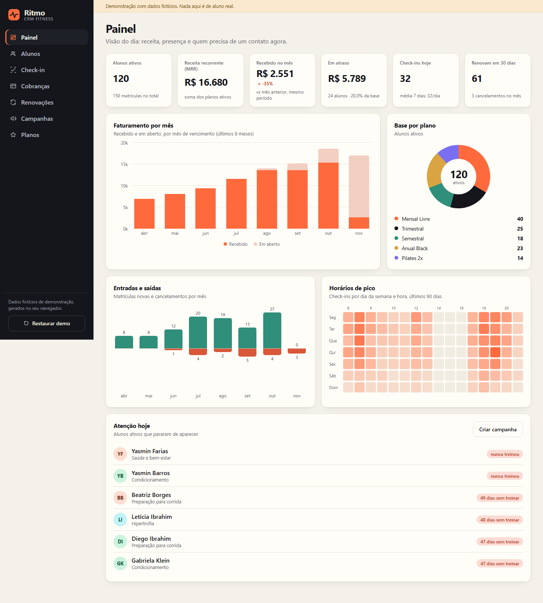
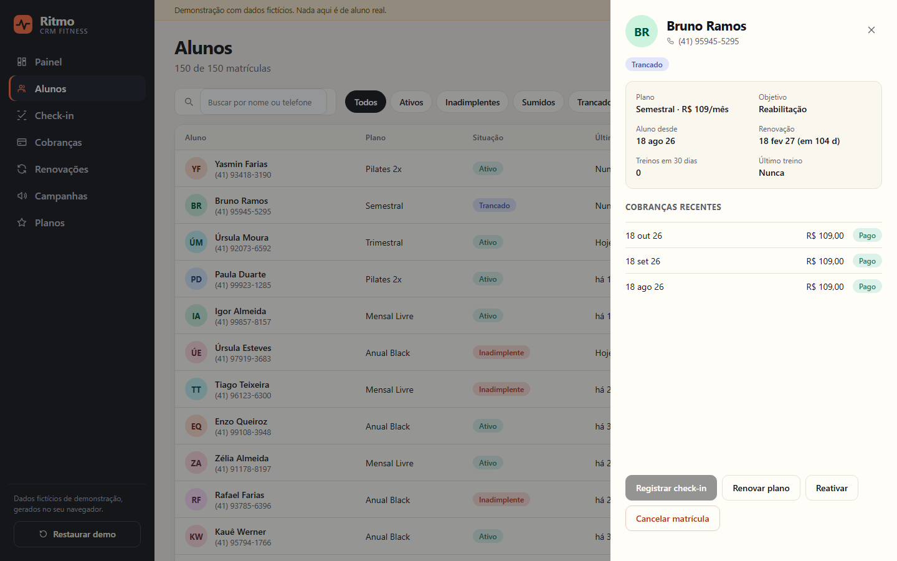
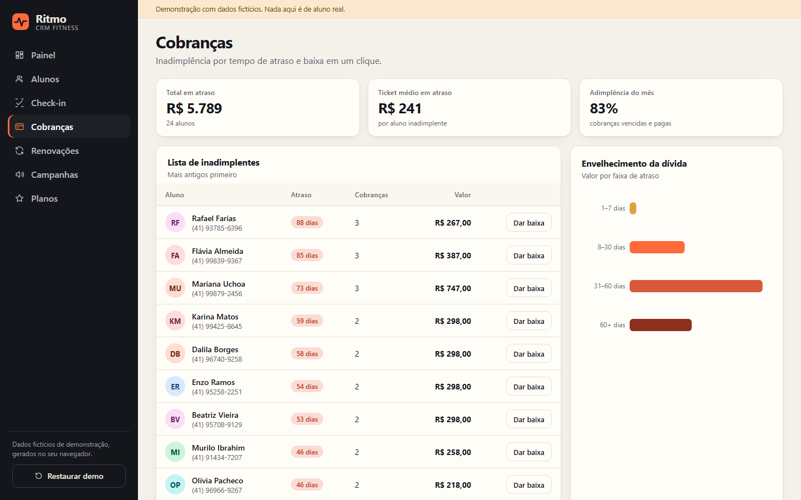
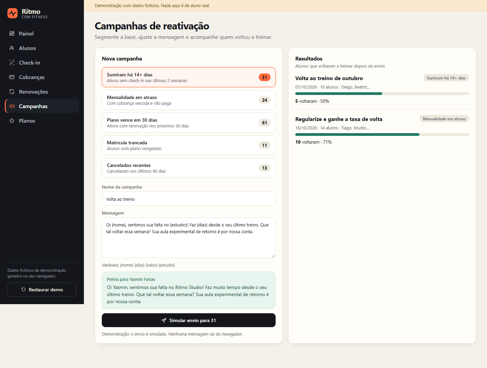
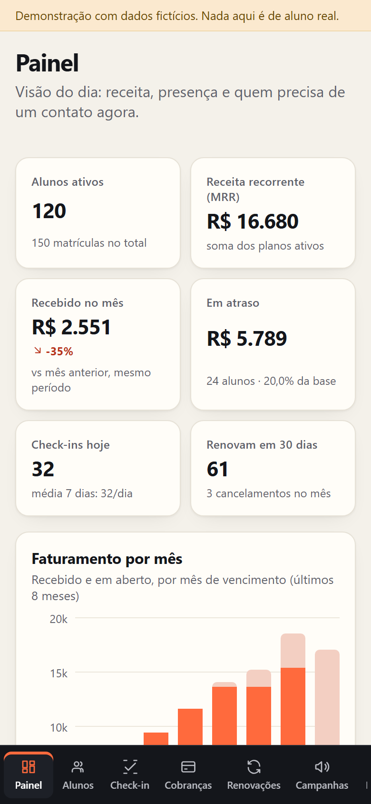

# Ritmo — CRM for gyms and fitness studios

[](https://github.com/alissonlittig/ritmo-crm-fitness/actions/workflows/pages.yml)

**Live demo:** https://alissonlittig.github.io/ritmo-crm-fitness/

A front-end CRM for a gym or boutique studio: members, plans, front-desk check-in, overdue payments, renewals and win-back campaigns, all in one responsive dashboard.

> **All data is fictional.** Names, phone numbers and payments are generated in your browser by a seeded generator. Nothing is sent anywhere; the campaign "send" button only simulates a send.



## What it does

| Screen | What you can do |
|---|---|
| **Dashboard** | MRR, cash received vs. the same period last month, overdue total, check-ins today, renewals due, revenue billed/open by month, plan mix, new vs. cancelled members, a weekday × hour heat map of attendance, and a "who stopped showing up" list. |
| **Members** | Search and filter (active, overdue, gone quiet 14+ days, frozen, cancelled), a member drawer with plan, goal, attendance, recent invoices, and actions: check in, settle overdue invoices, renew, freeze, cancel, reactivate. New enrollment form with validation. |
| **Check-in** | Front-desk search with one-tap entry. Frozen or cancelled members are blocked; duplicate check-ins on the same day are refused. |
| **Billing** | Delinquency list ordered by age, debt aging chart, average overdue ticket, collection rate for the month, one-click settlement. |
| **Renewals** | Members expiring in 30 days, grouped as expired / next 7 days / 8–30 days, with revenue at stake and one-click renewal (generates the next invoice). |
| **Campaigns** | Five segments built from live data, editable message templates with variables, a message preview, and results: a member counts as *reactivated* when they check in after the campaign was sent. |
| **Plans** | Catalogue with active members and monthly revenue per plan. |

The state persists in `localStorage` for the day; **Restore demo** regenerates the data set.

| Member drawer | Billing |
|---|---|
|  |  |

| Campaigns | Mobile (390 px) |
|---|---|
|  |   |

## Stack

- **React 19 + TypeScript** (strict), built with **Vite**
- **Zustand** for state, with `persist` middleware
- **Recharts** for the billing and plan charts; the dashboard uses lightweight CSS/SVG charts so the first screen stays fast
- **Vitest** for the domain logic (dates, segments, debt, templates, seed)
- No CSS framework: hand-written CSS with design tokens, a bottom tab bar and card-style tables on small screens
- GitHub Actions: install, test, build and deploy to GitHub Pages

## Design notes

- The seed generator is deterministic (`mulberry32`), so the demo looks the same for everyone, and relative to *today*: invoices, renewals and check-ins always line up with the current date.
- Business rules live in `src/lib.ts` (pure functions, unit-tested) and the UI only reads from them. For example, a member is in the **gone quiet** segment when active with no check-in for 14+ days; **overdue** means an unpaid invoice with a due date before today.
- Campaign results are computed, not stored: reactivation = recipients with a check-in after `sentAt`.
- Accessible by default: keyboard-operable rows, dialog roles, `aria-live` toasts, focus rings, reduced-motion support.

## Run locally

```bash
npm ci
npm run dev      # http://localhost:5173
npm test         # unit tests
npm run build    # type-check + production build into dist/
```

## Project layout

```
src/
  lib.ts          pure business rules and formatters
  seed.ts         deterministic fictional data
  store.ts        Zustand store (actions, persistence)
  App.tsx         shell, navigation
  Painel.tsx · Alunos.tsx · Gestao.tsx   screens
  ui.tsx          small shared components
```

## License

MIT. The data set is fictional and any resemblance to real people is coincidental.
